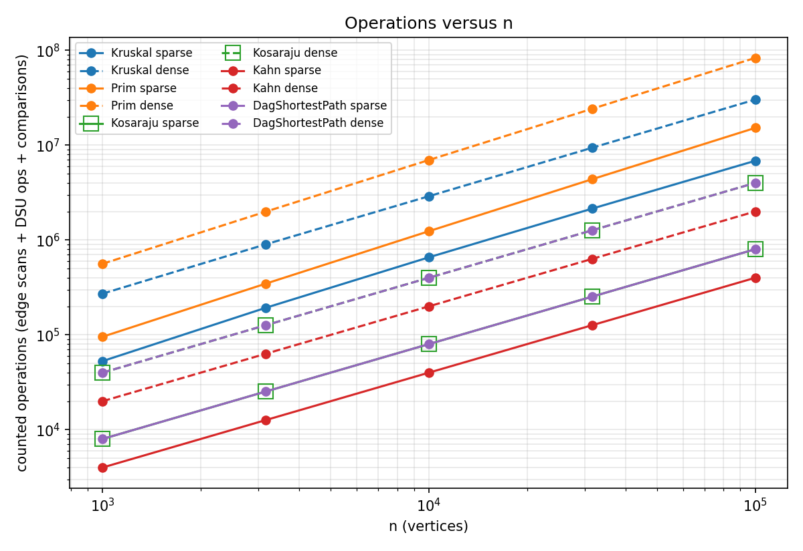
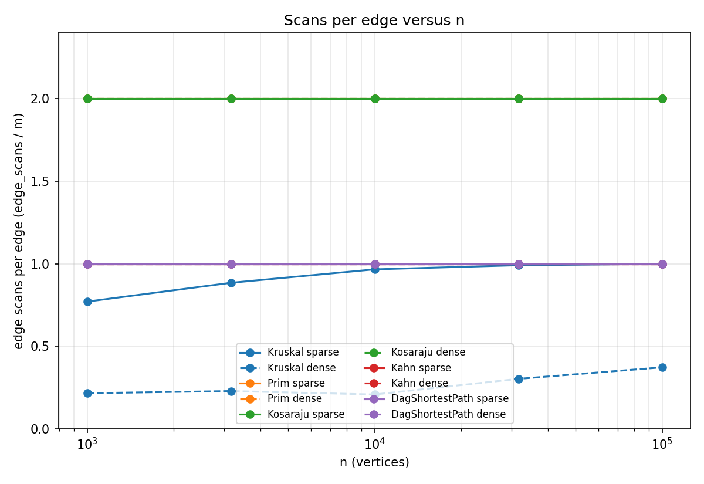
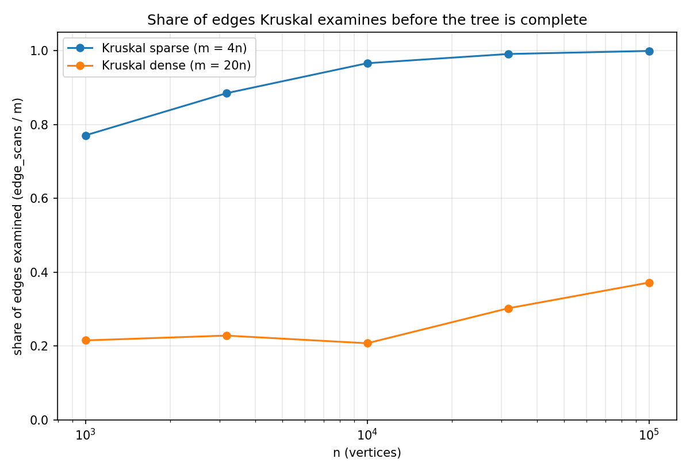

# Report: Graph Algorithms for the City Network and Job Scheduler

All numbers come from `results/results.csv`, produced by `daa.benchmark.Benchmark` (seed 42). The counters are
incremented inside the algorithms. The program reproduces all 30 reference values of the assignment exactly
(MST weight, SCC count, sum of DAG distances), and the scan counters are exactly 2m for Kosaraju and m for Kahn and
the DAG relaxation on every graph.

## 1. Complexity table

| Algorithm | Time | Extra space | Justification |
|---|---|---|---|
| DSU find / union | O(alpha(n)) amortized | O(n) | union by rank and path compression together give the inverse Ackermann bound |
| Kruskal | O(E log E + E alpha(V)) = O(E log V) | O(E + V) | the sort dominates, each examined edge costs two finds and at most one union; sorted copy of the edges plus the DSU arrays |
| Prim (binary heap, lazy) | O(E log E) = O(E log V) | O(E + V) | every adjacency entry is scanned once and may push one heap entry of cost O(log E); the heap holds up to E entries |
| Kosaraju | O(V + E) | O(V + E) | two DFS passes, each scans every edge once; the reversed graph is a second copy |
| Kahn | O(V + E) | O(V) | every vertex enters the queue once and every edge is decremented once |
| DAG shortest path | O(V + E) after the order | O(V) | one relaxation pass over the topological order, dist and parent arrays |
| Tarjan (bonus) | O(V + E) | O(V) | one DFS, index, lowlink and an active stack, no reversed graph |

## 2. Counters versus formulas

Each cell is the measured counter divided by the formula. A ratio that stays flat as n grows confirms the class.

**Counter divided by formula, sparse graphs (m = 4n)**

| algorithm | ratio | n=1000 | n=3162 | n=10000 | n=31623 | n=100000 |
|---|---|---|---|---|---|---|
| Kruskal | dsu_ops / E | 1.791 | 2.019 | 2.182 | 2.232 | 2.248 |
| Kruskal | comparisons / (E log2 E) | 0.891 | 0.907 | 0.869 | 0.809 | 0.745 |
| Prim | edge_scans / (2E) | 1.000 | 1.000 | 1.000 | 1.000 | 1.000 |
| Prim | comparisons / (E log2 V) | 2.196 | 2.186 | 2.180 | 2.178 | 2.167 |
| Kosaraju | edge_scans / (2E) | 1.000 | 1.000 | 1.000 | 1.000 | 1.000 |
| Kosaraju | edge_scans / (V + E) | 1.600 | 1.600 | 1.600 | 1.600 | 1.600 |
| Kahn | edge_scans / E | 1.000 | 1.000 | 1.000 | 1.000 | 1.000 |
| Kahn | edge_scans / (V + E) | 0.800 | 0.800 | 0.800 | 0.800 | 0.800 |
| DagShortestPath | edge_scans / E | 1.000 | 1.000 | 1.000 | 1.000 | 1.000 |
| DagShortestPath | edge_scans / (V + E) | 0.800 | 0.800 | 0.800 | 0.800 | 0.800 |

**Counter divided by formula, dense graphs (m = 20n)**

| algorithm | ratio | n=1000 | n=3162 | n=10000 | n=31623 | n=100000 |
|---|---|---|---|---|---|---|
| Kruskal | dsu_ops / E | 0.480 | 0.506 | 0.465 | 0.654 | 0.794 |
| Kruskal | comparisons / (E log2 E) | 0.903 | 0.846 | 0.784 | 0.720 | 0.666 |
| Prim | edge_scans / (2E) | 1.000 | 1.000 | 1.000 | 1.000 | 1.000 |
| Prim | comparisons / (E log2 V) | 2.616 | 2.533 | 2.473 | 2.421 | 2.381 |
| Kosaraju | edge_scans / (2E) | 1.000 | 1.000 | 1.000 | 1.000 | 1.000 |
| Kosaraju | edge_scans / (V + E) | 1.905 | 1.905 | 1.905 | 1.905 | 1.905 |
| Kahn | edge_scans / E | 1.000 | 1.000 | 1.000 | 1.000 | 1.000 |
| Kahn | edge_scans / (V + E) | 0.952 | 0.952 | 0.952 | 0.952 | 0.952 |
| DagShortestPath | edge_scans / E | 1.000 | 1.000 | 1.000 | 1.000 | 1.000 |
| DagShortestPath | edge_scans / (V + E) | 0.952 | 0.952 | 0.952 | 0.952 | 0.952 |

Reading the table:

- The traversals are exactly linear. `edge_scans / (2E)` for Prim and Kosaraju and `edge_scans / E` for Kahn and the
  DAG pass are 1.000 at every n. Against `V + E` the ratio is the constant 2E/(V+E) for Kosaraju (1.600 sparse, 1.905
  dense) and E/(V+E) for Kahn and the DAG pass (0.800 and 0.952), because the density is fixed.
- Prim: `comparisons / (E log2 V)` moves only from 2.20 to 2.17 (sparse) and from 2.62 to 2.38 (dense). It is bounded and
  almost flat, as expected for O(E log V).
- Kruskal sort: `comparisons / (E log2 E)` stays between 0.67 and 0.91. It drifts down slowly because merge sort needs
  fewer than E log2 E comparisons and the gap shrinks relative to the total as E grows, but it never leaves a bounded band.
- Kruskal DSU: `dsu_ops / E` is not flat, because Kruskal stops as soon as the tree has n - 1 edges and the share of
  edges it examines changes with n (section 5). The work per examined edge is flat: `dsu_ops / edge_scans` is 2.32 on
  the smallest sparse graph, 2.25 on the largest sparse graph, 2.23 and 2.13 on the smallest and largest dense graphs.
  That is two finds per edge plus the successful unions, which confirms the near-constant alpha(n) cost of the DSU.

## 3. Slope check

**Log-log slope of edge_scans versus n**

| algorithm | sparse | dense |
|---|---|---|
| Kruskal | 1.055 | 1.119 |
| Prim | 1.000 | 1.000 |
| Kosaraju | 1.000 | 1.000 |
| Kahn | 1.000 | 1.000 |
| DagShortestPath | 1.000 | 1.000 |

**Further slopes**

| counter | density | slope |
|---|---|---|
| Kruskal comparisons | sparse | 1.055 |
| Kruskal edge_scans + dsu_ops + comparisons | sparse | 1.054 |
| Prim comparisons | sparse | 1.108 |
| Kruskal comparisons | dense | 1.016 |
| Kruskal edge_scans + dsu_ops + comparisons | dense | 1.022 |
| Prim comparisons | dense | 1.090 |

Prim, Kosaraju, Kahn and the DAG pass have slope 1.000 for `edge_scans`, so they do linear work in the size of the graph
(m = 4n or 20n, so V and E grow together). Kruskal's `edge_scans` slope is 1.055 on sparse and 1.119 on dense graphs, so
it is slightly steeper, as the assignment predicted. For `edge_scans` the reason is the early stop: a random graph
becomes connected only after about (n/2) ln n of its edges have been seen in sorted order, so the number of examined
edges grows like n log n. The log factor of the sort itself shows in the comparison counter, whose slope is 1.055
(sparse) and 1.016 (dense). Prim's comparison slope is 1.108 and 1.090, again slightly above 1 because of log V.

## 4. Correctness arguments

**Cut property.** Let (S, V \ S) be any cut that no edge of a partial tree T crosses, and let e be a lightest edge
crossing it. Take any minimum spanning tree M that contains T. If M does not contain e, adding e to M creates a cycle,
and this cycle must cross the cut a second time through another edge f. Since e is lightest across the cut, w(e) <= w(f),
so M - f + e is again a spanning tree with weight at most w(M), and it still contains T and e. Hence some minimum
spanning tree contains T + e, so adding e is safe. Kruskal uses this with the cut between the DSU component of u and
everything else: the lightest remaining edge joining two different components is a lightest edge across that cut, and
edges inside one component (find(u) == find(v)) would close a cycle and are skipped. Prim uses it with the cut between
the tree and the rest: the heap returns the lightest edge leaving the tree, and a popped vertex that is already in the
tree is skipped. Both algorithms add only safe edges, so both end with a minimum spanning tree (or forest) of the same
total weight, which the benchmark checks automatically.

**Induction on the topological order.** Let v1, ..., vn be a topological order and let d*(v) be the true shortest
distance from the set of in-degree-0 vertices (the super-source). Claim: when vi is taken in the single pass, dist[vi]
equals d*(vi). For the first vertex this is true: it has no incoming edge, so it is a source and dist = 0. Assume the
claim for v1..v(i-1). Every edge into vi comes from some vj with j < i, since the order respects edges. A shortest path
to vi ends with such an edge, and its prefix is a shortest path to vj, so d*(vi) = min over incoming edges of
d*(vj) + w, or 0 if vi is a source. By the hypothesis dist[vj] = d*(vj) at the moment vj was processed, and vj relaxed
all its outgoing edges then, so dist[vi] has already been offered every candidate value and nobody lowers it later.
Hence one pass is enough, in O(V + E).

**Why negative weights are safe in a DAG but not in general.** The induction above never uses the sign of a weight, only
that edges go forward in the order. Dijkstra needs non-negative weights because it finalizes the closest vertex first,
which fails when a later edge can reduce a finalized distance. Bellman-Ford allows negative edges but needs V - 1 rounds
and breaks down on a negative cycle, where "shortest" is undefined. A DAG has no cycles at all, so no negative cycle can
exist and every vertex is reached by finitely many simple paths.

## 5. Share of edges Kruskal examines

**Share of edges Kruskal examines (edge_scans / m)**

| graph | n=1000 | n=3162 | n=10000 | n=31623 | n=100000 |
|---|---|---|---|---|---|
| Kruskal sparse | 0.770 | 0.885 | 0.966 | 0.991 | 0.999 |
| Kruskal dense | 0.215 | 0.228 | 0.207 | 0.302 | 0.372 |

On sparse graphs (m = 4n) Kruskal ends up looking at 77% of the edges at n = 1000 and 99.9% at n = 100 000, because the
graph is only a little above the connectivity threshold, so the last edge that joins the final components is among the
heaviest. On dense graphs (m = 20n) it stops after 21% to 37% of the edges, since the sorted prefix already connects the
graph. Prim always scans every adjacency entry, 2m in total. Plot: `results/plots/kruskal_share.png`.

## 6. Which algorithm when

| Situation | Choice | Why |
|---|---|---|
| MST, edges given as an edge list | Kruskal | sorts the list directly and needs only a DSU; no adjacency structure to build |
| MST, dense graph (m = 20n here) | Kruskal (or Prim with an adjacency matrix when V^2 is about E) | Kruskal stopped after 21 to 37% of the edges and used 27.9M comparisons against 79.1M for heap Prim at n = 100 000 |
| MST, sparse graph, adjacency list | Either; Kruskal had fewer comparisons in our runs (5.5M against 14.4M at n = 100 000) | both are O(E log V); Prim avoids sorting all edges but pays heap pushes |
| MST on a disconnected graph | Either, both return a forest | Kruskal ends with several DSU components, Prim restarts from the next unvisited vertex |
| Strongly connected components | Tarjan when scans and memory matter, Kosaraju when the reverse graph is already available or simplicity is wanted | Tarjan scans m edges and builds no reverse graph, Kosaraju scans 2m |
| Dependencies, cycles possible | Kahn, then Kosaraju or Tarjan on failure | Kahn reports a cycle when fewer than n vertices leave the queue; the SCCs then show the deadlocked groups |
| Dependencies, known acyclic | Kahn or DFS order | O(V + E) either way; Kahn needs no recursion |
| Shortest paths in a DAG, any weight sign | topological relaxation | O(V + E), handles negative weights |
| Shortest paths with cycles, weights >= 0 | Dijkstra | greedy order works without a topological order |
| Shortest paths with cycles and negative weights | Bellman-Ford | O(VE), detects negative cycles |
| Longest path / critical path | condensation, then relaxation with the sign flipped | only possible in a DAG |

## 7. Plots

The first plot shows operations (edge scans + DSU operations + comparisons) on log-log axes. Kosaraju (hollow squares)
lies exactly under DagShortestPath because both count 2m operations: Kosaraju 2m scans, the DAG pass m scans and m
comparisons. The lines are almost parallel with slope near 1, with the Kruskal and Prim lines slightly steeper because of the log factor. The second plot
shows scans per edge: Kosaraju sits at 2.0, Prim at 2.0, Kahn and the DAG pass at 1.0, and Kruskal rises towards 1.0 on
sparse graphs and stays below 0.4 on dense graphs.

## 8. Stack safety

The DFS in Kosaraju and Tarjan uses an explicit `int[]` stack plus a per-vertex edge pointer. The deepest stack was
59 668 entries at n = 100 000 (sparse) and 91 920 (dense), far beyond what the JVM call stack would take. The
JUnit tests also run a path and a cycle of 100 000 vertices through both algorithms without `StackOverflowError`.

## 9. Bonus

**Tarjan.** It returns the same partition as Kosaraju on every benchmark graph (checked automatically) and on 60 random
graphs in the tests. It scans m edges instead of 2m (2 000 000 against 4 000 000 on the largest dense graph) because the
lowlink values identify component roots during the first and only DFS, so there is no second pass over a reversed
graph and no reverse graph in memory. Its median time on the largest dense graph was about 126 ms against about 580 ms
for Kosaraju on the same machine, but the counter is the evidence.

**Condensation and critical path.** Contracting every SCC gives a DAG (a cycle between components would merge them).
On the sparse graphs the condensation has 94, 488, 1 464, 4 686 and 15 524 edges for n = 1 000 to 100 000 and the
longest path has weight 3 053, 2 992, 3 779, 3 952 and 4 977. On the dense graphs everything is one SCC, so the
condensation is a single vertex with a path of weight 0 (`results/condensation.csv`). The longest path is found by
negating the weights and running the same one-pass relaxation. It is easy in a DAG because paths cannot repeat
vertices and the topological order fixes the evaluation order; in a general graph a positive cycle would make the longest
walk unbounded, and the longest simple path is NP-hard (it contains Hamiltonian path). The critical path method in
project scheduling uses exactly this: the longest chain of dependent jobs sets the minimum project duration, and jobs on
it have zero slack.

## 10. Time

Median wall-clock times over five runs are in the CSV, for example Kruskal 446 ms, Prim 1 936 ms and Kosaraju 578 ms on the largest dense graph. They show the same ranking as the counters,
but I do not use them as evidence. They depend on the machine, the JVM version, JIT warm-up and garbage collection and
background load: the two smallest graphs are dominated by JIT warm-up (for instance the Kahn dense time at n = 1 000 is
larger than at n = 3 162), and two runs of the same benchmark on the same machine differed by several percent. The
counters are produced by the algorithms themselves and are identical on every machine.

**Median time in ms over 5 runs**

| algorithm | n=1000 | n=3162 | n=10000 | n=31623 | n=100000 |
|---|---|---|---|---|---|
| Kruskal sparse | 5.7 | 7.9 | 17.4 | 41.7 | 80.1 |
| Kruskal dense | 22.0 | 45.8 | 45.3 | 138.6 | 446.4 |
| Prim sparse | 7.7 | 7.1 | 11.5 | 51.4 | 264.4 |
| Prim dense | 17.2 | 25.0 | 79.8 | 456.4 | 1936.4 |
| Kosaraju sparse | 5.5 | 5.4 | 13.1 | 26.1 | 185.6 |
| Kosaraju dense | 5.6 | 20.7 | 23.3 | 133.9 | 577.5 |
| Kahn sparse | 0.6 | 0.3 | 1.2 | 8.4 | 22.4 |
| Kahn dense | 4.7 | 0.7 | 7.4 | 19.1 | 70.3 |
| DagShortestPath sparse | 0.7 | 1.4 | 3.6 | 9.3 | 23.9 |
| DagShortestPath dense | 0.7 | 6.2 | 9.9 | 21.2 | 93.8 |

